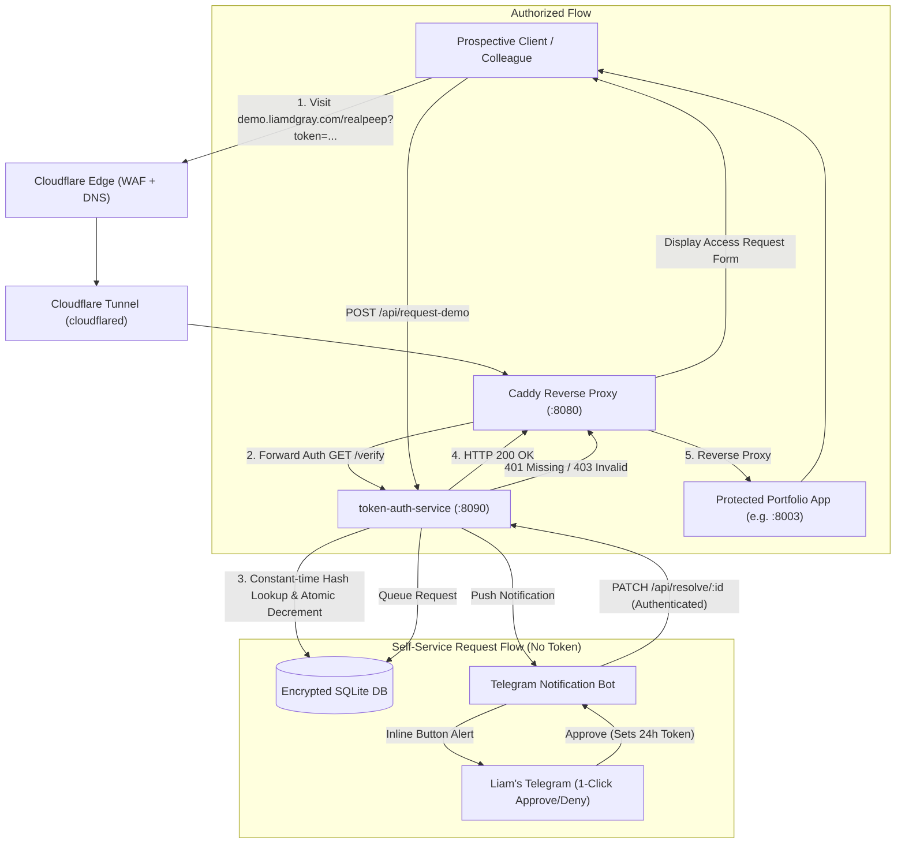

# Token Auth & Demo Gatekeeper Service (`token-auth-service`)

> **Zero-Trust Portfolio Gatekeeper**: A lightweight, high-performance forward-authentication microservice, token issuer, and out-of-band access approval engine designed to securely grant prospective clients and colleagues granular, time- and use-bounded access to live portfolio demos behind a reverse proxy (Caddy / Cloudflare Tunnel).

---

## 1. Executive Summary: Should It Be Promoted to Its Own Repo?

### Recommendation: **Promote to a Dedicated Standalone Repository (`gatekeeper` or `token-auth-service`)**

While keeping `token-auth-service` co-located inside the `demo-gallery` monorepo offers atomic updates between the frontend UI and Caddyfile routing, **promoting it to an independent repository is strongly recommended if the primary objective is to absolutely maximize security**.

#### Architectural Trade-off Analysis:

| Architectural Dimension | Monorepo (`demo-gallery`) | Standalone Dedicated Repo | Security Verdict |
| :--- | :--- | :--- | :--- |
| **Blast Radius & Principle of Least Privilege** | Frontend changes, gallery assets, and auth code share commit logs, write permissions, and deployment access. | Auth engine is completely isolated; access to modify authentication logic requires distinct repository permissions. | **Standalone wins** |
| **Secret Segregation** | Admin keys (`DEMO_AUTH_SECRET`), bot tokens (`DEMO_APPROVAL_CHAT_ID`), and scanner baselines are shared across gallery tooling. | Secrets, deploy keys, and CI/CD environment secrets are strictly segregated to the auth service. | **Standalone wins** |
| **Attack Surface & Auditing** | `git log` and PR audits mix marketing UI updates with security-critical auth changes. | 100% of pull requests, commits, and releases focus strictly on security, auth logic, and cryptography. | **Standalone wins** |
| **Specialized Security CI/CD** | Secret scanners, SAST (Semgrep/Bandit), DAST, and container vulnerability scans (Trivy) run on mixed assets. | Rigorous automated security pipelines (reproducible minimal distroless builds, dependency CVE alerts, fuzz testing). | **Standalone wins** |
| **Cross-Service Reusability** | Gating non-gallery assets (e.g., staging apps, internal tools, client mockups) requires coupling them to `demo-gallery`. | Can serve as an organizational gatekeeper for any private domain or subdomain across any number of client projects. | **Standalone wins** |
| **Deployment Atomicity** | Single `git pull` updates Caddyfile, gallery web UI, and auth backend simultaneously. | Requires managing release versions or git submodules if schemas change in lockstep. | *Monorepo slightly simpler* |

---

## 2. FOSS Ecosystem Comparison

Existing open-source authentication proxies either focus on heavy enterprise Single Sign-On (OIDC/SAML/LDAP) or simple OAuth forwarding, lacking the specialized guest-request and 1-click out-of-band approval workflow needed for client portfolio demos.

| Feature / Capability | `token-auth-service` | [Authelia](https://github.com/authelia/authelia) | [Pomerium](https://github.com/pomerium/pomerium) | [Traefik Forward Auth](https://github.com/thomseddon/traefik-forward-auth) | [Vouch Proxy](https://github.com/vouch/vouch-proxy) | [Caddy-Security](https://github.com/greenpau/caddy-security) |
| :--- | :--- | :--- | :--- | :--- | :--- | :--- |
| **Core Architecture** | Forward Auth microservice (FastAPI/Uvicorn) | Full-featured Auth & SSO Companion | Identity-Aware Proxy (BeyondCorp / IAP) | Lightweight Forward Auth | Forward Auth Microservice | Embedded Caddy Authentication Plugin |
| **Primary Target Audience** | Prospects, clients, colleagues (Guest access) | Corporate internal enterprise users | Corporate remote zero-trust workforce | Self-hosted homelab / dev teams | Corporate / Team SSO | Caddy web server deployments |
| **Guest / Prospect Request Flow** | **Native**: Self-service modal (`/api/request-demo`) | None (Assumes pre-provisioned user directory) | None (Requires IdP identity) | None (OAuth only) | None (OAuth only) | None (Pre-defined users or external IdP) |
| **Out-of-Band 1-Click Approval** | **Native**: Telegram Bot with interactive inline buttons | None (No push notification approval queue) | None | None | None | None |
| **Cryptographic Link Gating** | High-entropy SHA-256 hashed URL tokens | Cookie/Session based | Session/JWT based | OAuth cookie based | OAuth cookie based | JWT / Session cookie based |
| **Granular Use & Time Bounds** | **Native**: `expires_at`, `max_uses` (e.g., single-use) | Timeouts only (no single-use demo links) | Session timeouts | Cookie expiration | Cookie expiration | JWT expiration |
| **Path-Prefix Restriction** | **Native**: Token bound strictly to `/demo-id/*` | Path-based ACLs in YAML config | Route policy in YAML | Limited host/path rules | Host/path rules | Dynamic path/claim matching |
| **Resource Footprint** | Extremely lightweight (~40MB RAM container, SQLite) | Medium (~100-250MB, requires Redis/SQL) | Heavy (Full Envoy-based Go proxy) | Tiny (~20MB Go binary) | Tiny (~25MB Go binary) | Zero extra process (embedded in Caddy) |
| **Infrastructure Overhead** | Zero dependencies beyond Python & SQLite | Requires Redis/Postgres & LDAP/File backend | Requires IdP integration & Envoy proxying | Requires Google/GitHub/OIDC IdP account | Requires OIDC IdP provider | Requires compiling Caddy with xcaddy |
| **Built-in Demo Analytics** | **Yes**: Tracks views, feature clicks, errors | No (Security audit logs only) | No (Traffic logs only) | No | No | No |

---

## 3. Threat Modeling & Security Hardening Roadmap

To **absolutely maximize security** for prospect and colleague access, the following hardening steps must be addressed:

### Priority 1: Critical Perimeter & Access Control Fixes

1. **Eliminate Untrusted `X-Forwarded-For` Header Spoofing:**
   - *Current Risk*: `/verify` inspects `X-Forwarded-For` to bypass auth for loopback/gateway IPs. An external attacker can send `X-Forwarded-For: 127.0.0.1` and gain unrestricted access if intermediate proxies do not strip client-supplied headers.
   - *Hardening*:
     - Trust `request.client.host` directly, or validate Cloudflare's authenticated `Cf-Connecting-Ip`.
     - Separate internal management/bypass endpoints onto a distinct UNIX domain socket or localhost-only port (e.g., `:8091`), never relying on headers on public-facing ingress.

2. **Authenticate the Resolution & Queue Endpoints:**
   - *Current Risk*: `GET /api/pending` and `PATCH /api/resolve/{rid}` have no authentication checks. Anyone who probes `/api/pending` can view pending visitor emails/IPs and self-approve access.
   - *Hardening*: Require HMAC-authenticated bot tokens or `X-Admin-Key` on both `/api/pending` and `/api/resolve/{rid}`.

3. **Replace String Equality with Constant-Time Comparison:**
   - *Current Risk*: `key == SECRET` is susceptible to side-channel timing attacks.
   - *Hardening*: Use `secrets.compare_digest(key, SECRET)`.

4. **Strict CORS Policy:**
   - *Current Risk*: `allow_origins=["*"]` allows cross-origin requests from arbitrary websites to the API.
   - *Hardening*: Restrict `allow_origins` strictly to `["https://demo.liamdgray.com", "http://localhost:8000"]`.

---

### Priority 2: Token Security & Cryptographic Integrity

5. **Cryptographic Token Generation:**
   - Use `secrets.token_urlsafe(32)` instead of string-concatenated `uuid4().hex`.
   - Store tokens using salted HMAC-SHA256 (`hmac.new(SECRET_KEY, token, hashlib.sha256)`).

6. **Race Condition Prevention on Single-Use Tokens:**
   - *Current Risk*: The sequence `SELECT` followed by `UPDATE` allows concurrent requests to use a single-use token simultaneously before it is deleted.
   - *Hardening*: Execute an atomic conditional decrement:
     ```sql
     UPDATE tokens
     SET uses = uses + 1
     WHERE token_hash = ?
       AND expires_at > ?
       AND (max_uses = 0 OR uses < max_uses);
     ```
     Check SQLite `changes()`: if 0, deny access immediately.

7. **Strict Path Canonicalization & Traversal Prevention:**
   - Canonicalize incoming URIs (`posixpath.normpath(uri)`) to prevent traversal tricks (`/demo/../admin`).
   - Enforce segment boundary checking: `uri == path or uri.startswith(path.rstrip('/') + '/')`.

---

### Priority 3: Defense-in-Depth & Anti-Abuse

8. **Rate Limiting & Proof-of-Work on `/api/request-demo`:**
   - Implement IP-based sliding-window rate limiting (e.g. max 3 requests per IP per hour) to prevent database exhaustion and Telegram notification spamming.
   - Add honeypot fields and optional Cloudflare Turnstile token validation for web forms.

9. **Input Validation & Payload Sanitization:**
   - Enforce Pydantic bounds: `email: EmailStr`, `reason: constr(max_length=500)`, `demo_id: constr(regex=r'^[a-z0-9\-]+$')`.
   - Sanitize Markdown/HTML characters in visitor reasons before forwarding them to the Telegram Bot API to eliminate Markdown injection.

10. **Container Sandboxing & Zero-Trust Runtime:**
    - Run container as an unprivileged non-root user (`USER 10001:10001`).
    - Mount the filesystem as read-only (`--read-only`), providing a writable `tmpfs` only for `/tmp` and the SQLite directory.
    - Drop all Linux capabilities: `--cap-drop=ALL --security-opt=no-new-privileges:true`.

---

## 4. Architecture Diagram



---

## 5. Local Development & Verification

### Running the Test Suite
```bash
pytest -v
```

### Running with Podman (Rootless, Sandboxed)
```bash
podman run -d \
  --name token-auth \
  --read-only \
  --cap-drop=ALL \
  --security-opt=no-new-privileges:true \
  -p 127.0.0.1:18007:8090 \
  -v ~/.demo:/data:Z \
  -e DEMO_DB_PATH=/data/auth.db \
  -e DEMO_AUTH_SECRET="<random-secure-hex>" \
  token-auth:latest
```
